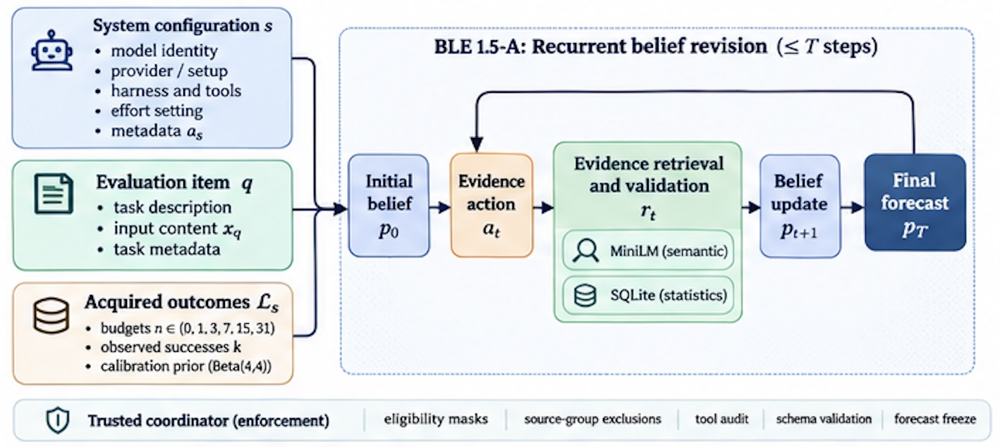

# BLE 1.5-A — Reviewer Reproduction

**Official formative Brier ALC 0.1590607804 · Codabench #1032237 · 9 groups · 489 evaluated pairs · budgets 0, 1, 3, 7, 15, 31**

**Reviewer package `v1.5.1-repro.1` · published as post-competition documentation on 2026-11-09.**

The [original competition repository](https://github.com/KarimGhandour/PAIEC-code-submission) and immutable scored-source
release `v1.5.0-rc.1` remain unchanged. This repository packages reviewer tooling
and documentation; it is not a new forecasting algorithm or competition submission.

BLE predicts whether an AI subject will succeed on a target task. GPT-6 Luna
Medium/Standard forms a belief, requests admissible local MiniLM/SQLite evidence,
and revises its probability. The scored BLE 1.5-A implementation uses the
Completion 001 readout policy. AIMS Foundations introduced the original BLE;
this repository records our implementation, evidence auditing, controlled
research and scored deployment.

| Start here | Purpose |
|---|---|
| **[Reproduce the permitted portions](REPRODUCE.md)** | One offline command, exact asset checks and the authorized inference boundary |
| [Flagship executed notebook](notebooks/01_BLE_1_5A_Explained.ipynb) · [browser view](https://nbviewer.org/github/KarimGhandour/PAIEC-code-submission/blob/v1.5.0-rc.1/notebooks/01_BLE_1_5A_Explained.ipynb) | Educational walkthrough; synthetic code examples and released aggregate analyses |
| [Observed trajectory notebook](notebooks/02_BLE15A_Observed_Trajectory.ipynb) | Authentic historical telemetry, with protected prompt/evidence omitted |
| [Scored source](hosted-ble15a/runtime/) · [source equivalence](docs/SOURCE_EQUIVALENCE.md) | All 35 Python modules match the local scored ZIP |
| [Results and verification scope](RESULTS.md) | Hosted feedback, historical CLI research, mock engineering tests and their limits |
| [Security and organizer setup](SECURITY_AND_ACCESS.md) | Own-key environment injection; no public credential |
| [Reproduction status and clean-room QA](docs/REVIEWER_QA.md) | Tested portions, authorized-asset checks and remaining gates |
| [Original immutable release](https://github.com/KarimGhandour/PAIEC-code-submission/releases/tag/v1.5.0-rc.1) · [technical report](paper/PAIEC_BLE_NeurIPS2026_Reconstructed.pdf) | Immutable public release and approved report snapshot |

## Which ZIP is which?

| Artifact | Exact size | What a reviewer receives |
|---|---:|---|
| OpenReview supplement | **579,597 bytes** | Source-plus-asset reconstruction package, prepared for the form’s **100 MB limit** |
| Original public GitHub release ZIP (`v1.5.0-rc.1`) | **8,589,884 bytes** | Public-safe source, tests, notebook, aggregates and documentation |
| Original scored `PAIEC_BLE15_A_PRODUCTION_001.zip` | **695,451,321 bytes** | Complete deployed assets and private scoring configuration; contains an API credential and is not a public download |

**Neither small package independently reconstructs the exact scored runtime.**
Six derived evidence/firewall files are omitted pending authorized access and
redistribution clearance. The pinned public MiniLM weight is a seventh external
file. Exact paths, sizes, hashes and lineage are in the [asset inventory](hosted-ble15a/RESTRICTED_ASSETS.md)
and [DATA_PROVENANCE.md](DATA_PROVENANCE.md). Raw gated Measurement DB access alone
has no verified procedure for regenerating all six exact files.

The existing reconstructor assembles and hash-verifies a credential-free runtime
when exact authorized assets are supplied. It does not obtain permission or invent
missing data. The 695 MB original must never be linked or published unchanged.
The OpenReview supplement is not currently a separate downloadable GitHub release
asset; use its released contents under [hosted-ble15a](hosted-ble15a/).

## Run the public offline checks

Use Python 3.12 with SQLite FTS5, from a clone of this reproduction repository:

```sh
git clone https://github.com/KarimGhandour/PAIEC-BLE15A-Reproduction.git
cd PAIEC-BLE15A-Reproduction
python3.12 -m venv .venv-notebook
. .venv-notebook/bin/activate
python -m pip install -r requirements-notebook.txt
python scripts/reproduce.py offline --notebooks
```

Dependency installation uses the package index. The subsequent command needs no
network, API key, pretrained weights or restricted corpus. It checks actual frozen
controller code with explicitly invented fixtures at all six budgets, failure and
admissibility rules, public aggregate arithmetic and observed telemetry. It executes
both notebooks and writes fresh copies and HTML under ignored `outputs/`.
See [REPRODUCE.md](REPRODUCE.md) for exactly what each check establishes. These
helper commands are part of this dedicated reviewer package, not the original
competition upload. [Publication provenance](PUBLICATION_PROVENANCE.json) records
the reviewed baseline and separates this work from the original submission.



## The scored method and evidence

1. The target identifies the subject, task and legitimately revealed labels.
2. Luna returns a structured belief and a JSON action.
3. Python enforces exclusions. MiniLM proposes related records; SQLite returns
   admissible evidence and recomputes affected counts after exclusions.
4. Luna can revise its belief. Completion returns a validated final submit or an
   explicitly distinguished earlier model belief; individual failures have a
   separately labeled emergency path.

The model-visible prompt retains the original five-action wording. **The scored
controller accepts at most three valid actions, at most four Responses requests
including repair, and a 31-second inference window after initialization.**
BLE 1.5-A is not an unbounded five-action deployment. See [architecture](docs/architecture.md).

| Evidence | Result | Interpretation |
|---|---|---|
| Hosted BLE 1.5-A | **0.1590607804 Brier ALC** | Official formative feedback for #1032237; no public hidden-label rerun |
| Historical paired CLI R1 research | **0.203883 → 0.153728 mean Brier** | Frozen 32-question public panel at budgets 0 and 7; different implementation context, sample and aggregation |

The public research comparison is not a matched baseline for the hosted result.
The notebook’s miniature evidence and mocked API replies are invented examples.
The observed-trajectory notebook separately shows a genuine historical Standard
API execution, with no released target outcome and no claim of accuracy improvement.
[RESULTS.md](RESULTS.md) maps the claims to their verification limits.

## Reproducibility and access

Public source, synthetic tests, notebooks and aggregate arithmetic are reproducible.
Exact local evidence retrieval and genuine live inference require the six authorized
assets, pinned MiniLM and supported dependencies. Official hidden scoring additionally
requires the organizer’s private evaluation inputs, labels, acquisition process and
runner. An API key alone supplies none of those assets or evaluation data.

The original archive hash is
`90a6a22560328e4ff5ec3f86375dbf567aecf802d2632fe6829878b339be7c3c`.
The preserved full reconstruction matched 70/72 member contents, with only the
sanitized configuration and regenerated hash manifest differing. This was validated
with authorized local assets, not independent public asset regeneration.
The final score does not reveal runtime, worker concurrency or native-finalization coverage.

## Historical provenance and attribution

Historical R1 remains under [submission/](submission/), [its research guide](docs/research_r1_readme.md)
and the unchanged [v1.0.0-r1 release](https://github.com/KarimGhandour/PAIEC-code-submission/releases/tag/v1.0.0-r1).
Fast A.2 #1033843 failed with `PAIEC-UNKNOWN-001`; its exact cause remains unknown.
The [decision ledger](results/decision_ledger.csv) retains negative and inconclusive research.

Report/release: **Karim Ghandour**. Original BLE architecture and baseline:
**[AIMS Foundations](https://github.com/aims-foundations/paiec_baseline)**.
See [CITATION.cff](CITATION.cff), [MIT code license](LICENSE) and
[third-party notices](THIRD_PARTY_NOTICES.md). The code license does not relicense
external data, model assets, provider output or access permissions.
